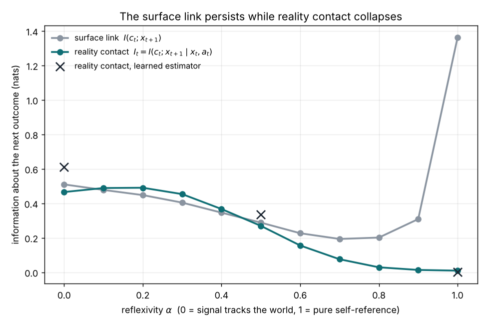

# Reality contact

**Does a coordination signal still track the world, or has it started feeding on its own past?**

Interactive sandbox (runs in the browser, no install): https://claude.ai/artifact/BwA5aRoozPVcxshuKqEjBH



## Why this exists

Prices, consensus views and dashboards let many people act together without
each checking the world for themselves. A price tells a buyer about conditions
she will never see. A consensus view saves each reader from checking every
source. A dashboard lets a leader steer work he can't watch directly. These
signals earn that trust by staying in contact with what they describe.

The failure that matters is quiet. When participants start acting on the
signal itself rather than on what it describes, the signal begins to
recirculate the system's own past. It keeps predicting what happens next,
sometimes better than before, because everyone is now coordinating around it.
The usual test, whether the signal predicts outcomes, can't see the problem.
It passes right up to the point of failure.

AI speeds this loop up. Agents that trade against prices, models trained on
text other models wrote, and reports generated from earlier reports all make
it cheaper to act on the signal and costlier to go back to the world.

This toolkit asks a deliberately narrow question: of what a signal predicts,
how much is news the system couldn't have gotten from its own state? It does
not decide what is true. It flags to a person that a signal has gone circular,
so they know where to look.

## The measure

Two quantities, both in nats:

- **Surface link**, `I(c_t ; x_{t+1})`: does the signal `c_t` predict the next
  outcome `x_{t+1}`?
- **Reality contact**, `I_t = I(c_t ; x_{t+1} | x_t, a_t)`: does it predict
  anything the system didn't already know from its current state `x_t` and the
  actions agents took `a_t`?

When a signal is fed by the world, the two move together. When it becomes
reflexive, they split: the surface link persists or rises while reality contact
falls to zero. That divergence is the "scissors" in the figure above.

## The loop

Every setting this applies to has the same four parts:

- **World**: what is actually happening, changing on its own.
- **Signal**: a shared summary many agents rely on instead of checking the world directly.
- **Agents**: the people or programs that act on the signal.
- **Outcome**: what happens next, driven by both the world and the agents' actions. It becomes part of the record the next signal can draw on.

The signal can be fed from two directions. A signal fed by the world is
**exogenous**: it tells agents something they couldn't see from inside the
system. A signal fed by the system's own past outcomes is **endogenous**: it
tells agents what the system already did. Most real signals are a mix.
Reflexivity (`alpha`) sets the mix, and reality contact measures how much
exogenous information is still getting through.

## Where it applies

| Setting | World | Signal | Agents | Endogenous feed | What reality contact asks |
|---|---|---|---|---|---|
| Markets | Fundamentals | Price | Traders and trading agents | Trading on past prices | Does the price tell traders about fundamentals they couldn't already read off the market? |
| Shared knowledge | Facts | Consensus claims | Writers, readers, models | Citations of citations; models trained on model text | Does the consensus still carry new information about the facts, or only about earlier outputs? |
| Organizations | Ground truth of the work | Dashboards and status reports | Teams | Reports built from earlier reports | Does this week's report say anything leadership didn't already know? |

The sandbox has a "Read it as" switch that relabels the dials, the chart and a live diagram of this loop for each setting.

## Related ideas

- George Soros's theory of reflexivity: market participants' beliefs change the
  fundamentals they are trying to price.
- Goodhart's law: a measure that becomes a target stops being a good measure.
- Donald MacKenzie, *An Engine, Not a Camera* (2006): financial models can shape
  the markets they describe.
- Shumailov et al., "AI models collapse when trained on recursively generated
  data," *Nature* (2024).

This toolkit is an attempt to turn the shared intuition behind these into a
quantity you can estimate. It builds on my working papers on price and
reflexivity on SSRN ("Price as a Construct of Time," "When Price Becomes
Narrative") and my work as an Antikythera fellow on world models as
coordination substrates.

## Quick start

```
python3 -m venv .venv
source .venv/bin/activate
pip install numpy matplotlib scikit-learn
python src/run_synthetic.py
```

This sweeps reflexivity from 0 to 1, prints both quantities, and saves
`outputs/scissors.png`.

## What's inside

- `src/synthetic.py`: a synthetic economy with a reflexivity knob `alpha`. At
  `alpha = 0` the signal is the current state of the world; at `alpha = 1` it
  is a moving average of past outcomes. The reflexive part has to keep varying
  (so it still correlates with outcomes) while carrying nothing about the
  present; a frozen focal point, or a component built from variables already in
  the conditioning set, gives degenerate results instead.
- `src/mi_estimators.py`: two independent estimators.
  - `cmi_binning`: quantile binning with plug-in entropies and the
    Miller-Madow correction. NumPy only, fully transparent.
  - `learned_cmi`: the two-predictor trick. Train one classifier on
    `(x_t, a_t)` and one on `(x_t, a_t, c_t)` to predict the binned next
    outcome; the drop in held-out cross-entropy is `I_t`. This version scales
    to high-dimensional signals such as text embeddings.
- `src/run_synthetic.py`: the sweep and plot.

## Results

| alpha | reality contact I_t | surface link |
|------:|--------------------:|-------------:|
| 0.0 | 0.47 | 0.51 |
| 0.5 | 0.27 | 0.29 |
| 0.8 | 0.03 | 0.20 |
| 1.0 | 0.01 | 1.36 |

(nats, n = 20,000, seed 0; binning estimator)

At full self-reference the signal is more predictive on the surface than ever,
yet carries essentially no independent contact with reality. The learned
estimator agrees on the shape (0.61, 0.34 and 0.00 at alpha = 0, 0.5 and 1);
the two differ in level at low alpha, which is expected from their different
biases.

## Where it stops

The synthetic economy is a known-answer test, not evidence about real systems.
Applying the measure to a live loop (agents trading against a price, or a model
generating and judging its own claims) needs records of the system's state and
of what participants did; the estimator code itself does not change. Near
equilibrium a signal's variance can shrink, which shrinks every mutual
information at once. Telling a quiet signal from a circular one then needs a
counterfactual probe: nudge the signal and measure how far the expected
outcome moves. That is the next step.
